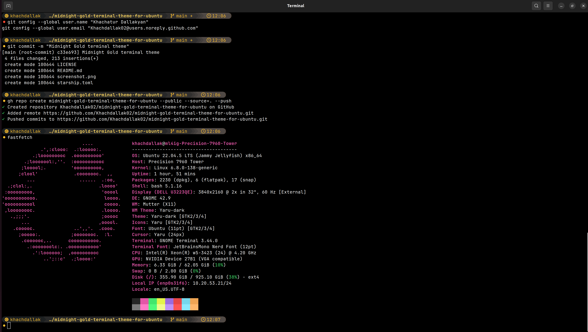

# Midnight Gold

A dark, golden-yellow terminal theme: [Starship](https://starship.rs) prompt for the Ubuntu terminal.



## Setup (Ubuntu)

**1. Nerd Font**
```bash
mkdir -p ~/.local/share/fonts && cd ~/.local/share/fonts
wget -q https://github.com/ryanoasis/nerd-fonts/releases/latest/download/JetBrainsMono.zip
unzip -o -q JetBrainsMono.zip && rm JetBrainsMono.zip
fc-cache -f && cd ~
```

**2. Use the font in GNOME Terminal**
```bash
P=$(gsettings get org.gnome.Terminal.ProfilesList default | tr -d "'")
gsettings set org.gnome.Terminal.Legacy.Profile:/org/gnome/terminal/legacy/profiles:/:$P/ use-system-font false
gsettings set org.gnome.Terminal.Legacy.Profile:/org/gnome/terminal/legacy/profiles:/:$P/ font 'JetBrainsMono Nerd Font 12'
```

**3. Starship**
```bash
curl -sS https://starship.rs/install.sh | sh -s -- -y
grep -q 'starship init bash' ~/.bashrc || echo 'eval "$(starship init bash)"' >> ~/.bashrc
```

**4. Theme**
```bash
mkdir -p ~/.config
curl -fsSL https://raw.githubusercontent.com/Khachdallak02/midnight-gold-terminal-theme-for-ubuntu/main/starship.toml -o ~/.config/starship.toml
exec bash
```

**5. Optional: fastfetch on startup**
```bash
sudo add-apt-repository -y ppa:zhangsongcui3371/fastfetch
sudo apt update && sudo apt install -y fastfetch
echo 'fastfetch' >> ~/.bashrc
```

## Customize

Edit the colors in `~/.config/starship.toml` under `[palettes.yellow_text]`.

## Uninstall
```bash
rm ~/.config/starship.toml
sed -i '/starship init bash/d' ~/.bashrc
```

Based on Starship's Gruvbox Rainbow preset.
